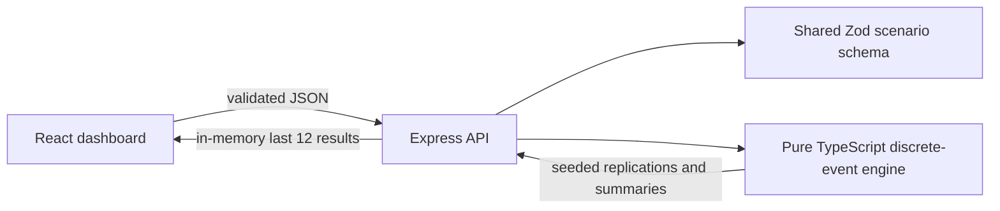

# Hospital Operations Digital Twin

Haven is an educational operations-planning demonstrator. Edit a representative hospital scenario, run reproducible discrete-event simulations, compare a capacity or routing change, and export assumptions with results.

**This is not a clinical system, a staffing directive, or a forecast of any real hospital.** All included scenario values are synthetic. Do not enter patient identifiers, protected health information, or facility confidential data.

## Run locally

Requires Node.js 22.12 or newer.

```sh
npm ci
npm run dev
```

Open http://localhost:5173. The editor starts with an example scenario. Choose **Run simulation** to generate both baseline and intervention results. The API runs locally on port 3001. No account, API key, data provider, or network service is required at runtime.

For a production build, run `npm run build` then `NODE_ENV=production npm start`. Or build and run the included Docker image:

```sh
docker build -t hospital-digital-twin .
docker run --rm -p 3001:3001 hospital-digital-twin
```

Open http://localhost:3001. The app uses no persistence: the API keeps the latest 12 results in process memory and discards them on restart. A new run is required to retrieve an expired or restarted result.

## Using the dashboard

1. Review or change arrivals in four six-hour blocks, acuity mix, service-time medians, ED providers/beds, inpatient beds, and admission share.
2. Set horizon, warm-up, replication count, and random seed.
3. Select an intervention (two added ED providers, four added ED beds, or a five percentage point lower admission share) and run the comparison.
4. Inspect the wait-time estimates, utilization, boarding, and hourly queue timeline. Export JSON for complete replication output or CSV for summary metrics.

The comparison pairs runs by reusing the same replication seeds. A 95% confidence interval is calculated across independent replications as mean ± 1.96 standard errors; it describes simulation variability under the entered assumptions. It is not a prediction interval for a real facility.

## Architecture



The Vite/React client and Express API are one deployable app. `shared/simulation.ts` has no web framework dependency and can be tested independently. `shared/model.ts` defines the input limits and output units. `server/app.ts` validates the API boundary, limits JSON request size and POST rate, uses Helmet security headers, and caps estimated event work. There is no authentication because there are no users or persistent records.

## Model card

**Purpose:** explore how simplified ED and inpatient capacity assumptions can affect queues and simulated waits. This model is not calibrated to a hospital and has not been validated against operational data.

**Entities and events:** synthetic arrivals move through a waiting queue, ED provider and bed service, and either ED discharge or an inpatient pathway. Event times are ordered in a binary min-heap. ED beds remain occupied during boarding. Inpatient capacity is released after a sampled stay; a waiting boarded patient then transfers and frees an ED bed.

**Assumptions:** arrivals follow a piecewise-constant Poisson process with four rates repeated over each 24-hour day. Acuity is sampled from the three user-entered proportions. ED service time is lognormal with the entered median and a fixed log-scale sigma of 0.35. Admission is a Bernoulli draw with a shared admission probability. Inpatient length of stay is exponential with the entered mean. Providers, ED beds, and inpatient beds are homogeneous pools. There is no priority queue by acuity; first-come-first-served is used.

**Measurement and accounting:** warm-up arrivals seed the system but are excluded from arrival, completion, and wait cohorts. The measurement horizon begins after warm-up. Completed means the patient leaves the simulated hospital system, including the inpatient stay for an admitted patient. At the horizon, `arrivals = completed + still in system` for the measured arrival cohort. Utilization is occupied ED or inpatient bed-minutes, or busy provider-minutes, divided by configured capacity times measurement minutes. Boarding is reported as occupied ED bed-hours for patients waiting for an inpatient bed. The result timeline includes replication-average ED and inpatient occupancy, waiting ED queue, and boarded patients at hourly snapshots.

Median and 90th percentile waits measure time to start ED care only among measured arrivals who reach care before the horizon. The dashboard and exports also report wait observations and patients still waiting at the cutoff for each replication. Those queued waits are not included in the percentiles, so interpret the percentiles together with the waiting count; a low percentile does not imply a short wait for patients still in queue.

**Uncertainty:** replications use independent deterministic seeds derived from the base seed. The paired intervention uses corresponding seeds. Summary confidence intervals use the normal approximation `mean ± 1.96 × sample standard deviation / √n`, clipped at zero for nonnegative measures. Intervals can vary non-monotonically for finite samples; more replications usually reduce sampling error but do not resolve input uncertainty or model error.

**Not modeled:** nonstationary surges within the six-hour blocks, acuity-dependent routing/priority, patient choice, left-without-being-seen, diagnostics and service stages, staffing skill mix and shift schedules, breaks, transfers, readmissions, local policies, or empirically calibrated distributions. The admission-share intervention changes routing probability by assumption and does not model clinical suitability. Do not use outputs for care, staffing, investment, or operational decisions.

## Data provenance and licensing

There is no external operational dataset or public hospital data in this MVP. Arrival, acuity, service-time, admission, and capacity defaults are synthetic and editable. Outputs are simulated values, never observations. This project does not claim national representativeness. As a result, external source attribution and data license do not apply. Software is licensed under MIT; see [LICENSE](LICENSE).

## API

- `GET /api/health` — health and model version.
- `POST /api/simulations` — validate a scenario, run it, and return a result. Scenario bounds are defined in `shared/model.ts`; JSON is limited to 64 KB, POST is limited to 20 requests per minute per IP, and estimated event work is capped. Runs execute synchronously one at a time in the Node event loop.
- `GET /api/simulations/:id` — retrieve one of the latest 12 process-local results.

There is no CORS allowlist because the UI and API are served from one origin. No user data is written to disk. Network logs should be configured by any hosting provider to avoid retaining request bodies or precise user-entered assumptions longer than necessary.

## Security and privacy notes

- No account, tracking, analytics, external data call, or patient record storage.
- Do not send protected health information or sensitive operational data; API inputs are retained temporarily in memory as reproducibility metadata.
- Helmet adds content-security and other security headers. Server errors do not echo submitted values. API responses contain scenario assumptions and should be treated as user-provided data.
- For public hosting, configure TLS, platform-level abuse protections, and logs without request bodies. The built-in per-process limiter is a basic guard and is not distributed across replicas.
- Threat notes: oversized payloads and excessive estimated event work are rejected; browser scripts are restricted by CSP; without accounts there are no session cookies or cross-site state changes. A publicly hosted instance exposes its run endpoint to anyone and its host may observe request metadata, so keep the rate limit and avoid confidential assumptions.

## Accessibility

Inputs have visible or accessible labels, controls are keyboard operable, charts have text alternatives, data is not communicated by color alone, and reduced-motion preferences are respected. The dashboard presents a chart and numeric summary so the flow does not depend on chart colors.

## Development and checks

```sh
npm run lint
npm run typecheck
npm test
npm run build
npx playwright install chromium
npm run test:e2e
```

The browser smoke test edits the example assumptions, selects an intervention, runs the paired comparison, checks the mobile layout, and downloads JSON. CI runs linting, type checks, unit/API/UI tests, build, and the Chromium smoke test on pull requests and pushes to `main`.

When deploying behind a reverse proxy, set `TRUST_PROXY_HOPS` to the exact number of trusted proxy hops and ensure the app cannot be reached around those proxies. It defaults to `0`, which ignores forwarded client-IP headers.

## Troubleshooting

- If port 3001 is occupied, set `PORT` in your environment; Vite reads the same value for its API proxy.
- If a run is rejected as too large, lower the horizon, arrival rates, or replication count; the API has a bounded work budget.
- Results disappear on server restart and after the in-memory cache evicts older runs; run the same seed and configuration again to reproduce them.
- If Playwright cannot launch Chromium, run `npx playwright install chromium`.

## Deployment

The Docker image serves the production UI and API on port 3001 and can be deployed to a Node-compatible container host. No provider account or paid service is configured here. Configure a free or paid host yourself, keep TLS enabled, and use the public-hosting security notes above. This repository currently has no live deployment.
